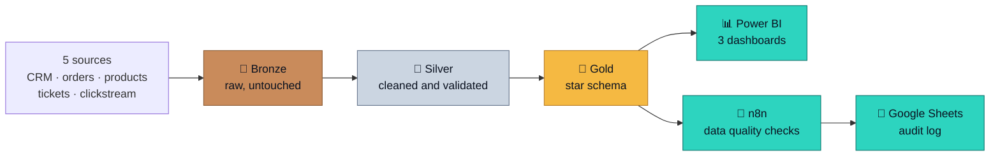

  

  
  
  
  

  

---

## 👋 Hi, I'm Abdallah

Computer Science graduate (2026) from Cairo. I build analytics that start with a business question: clean and validated data, a clear model, then dashboards people actually use.

| | |
|---|---|
| 🎓 | BSc Computer Science, Modern Academy, graduation project **A+** |
| 📍 | New Cairo, Egypt, open to roles in Egypt or remote |
| 🔭 | Currently refining **Customer360**: Databricks pipeline, n8n quality checks, Power BI |
| ⚽ | My graduation project was a football scouting system |
| 🎯 | Looking for an entry-level **Data Analyst / BI** role |

---

## 🧭 How I work: the Customer360 pipeline

**What it found:** 1,734 duplicate customer IDs, 1,040 missing emails and 11,163 orders flagged for data issues, across 300K+ order records.

  
  

---

## 🚀 Projects

| Project | Business question | Stack |
|---|---|---|
| [**Customer360 Analytics & Automation Platform**](https://github.com/abdallaatarekk/customer360-analytics-platform) | Can leadership trust one number across five systems? | `Databricks` `PySpark` `SQL` `Power BI` `n8n` |
| [**Telecom Customer Churn Analysis**](https://github.com/abdallaatarekk/Telecom-Churn-Analysis) | Who leaves, and what could keep them? | `SQL` `Power BI` |
| [**Global Geographic Analysis**](https://github.com/abdallaatarekk/Global-Geographic-Analysis) | How do 195+ countries compare on 10+ indicators? | `Power BI` `Power Query` |

---

## 🧰 Toolbox

<table>
  <tr>
    <td><b>Analyze</b></td>
    <td>
      
      
      
      
      
    </td>
  </tr>
  <tr>
    <td><b>Visualize</b></td>
    <td>
      
      
      
    </td>
  </tr>
  <tr>
    <td><b>Engineer</b></td>
    <td>
      
      
      
      
    </td>
  </tr>
  <tr>
    <td><b>Ship</b></td>
    <td>
      
      
      
      
    </td>
  </tr>
</table>

---

## 📈 GitHub activity

  

  Let's talk about your data → <a href="mailto:abdallahtarek.work@gmail.com">abdallahtarek.work@gmail.com</a>

